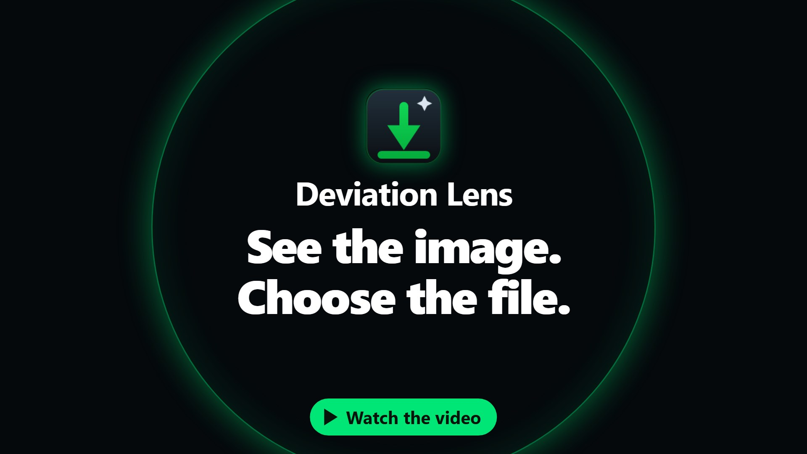
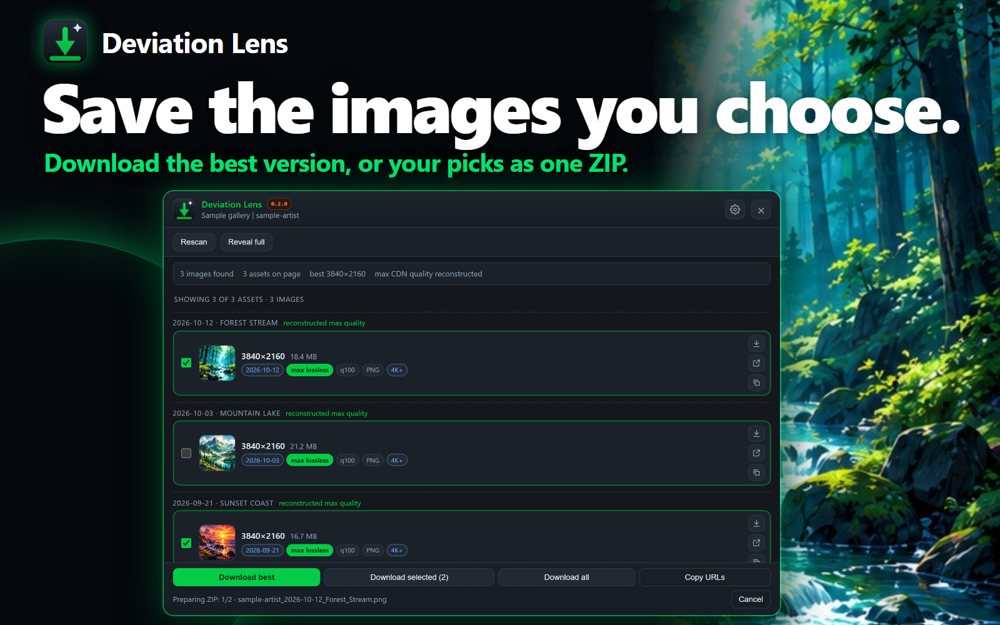
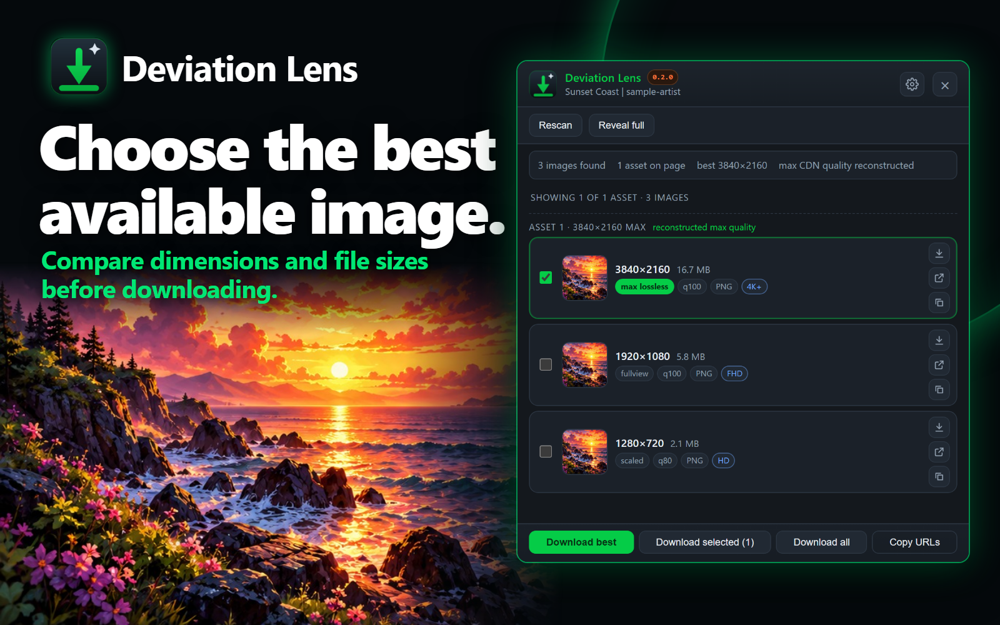
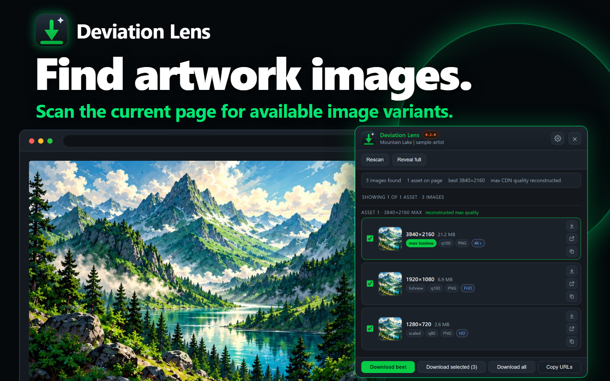
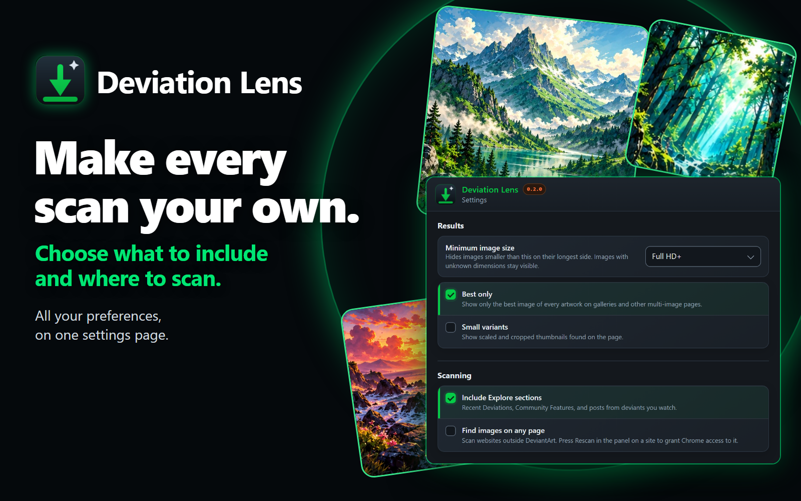

# Deviation Lens

Deviation Lens is the Chrome extension in [`apps/extension/`](apps/extension/) for finding image variants on the page you are viewing, comparing their available quality, and saving the images you choose.

[](https://jorgeadev.github.io/deviation-lens/#video)

**Version:** `0.2.0` · **Status:** Early access · **Minimum Chrome version:** 141

> The extension is in active development. Features and behavior may change before a stable release.

## Features

- Scan DeviantArt pages for supported images and available image variants.
- Review image dimensions, estimated file sizes, and quality details in the extension side panel.
- Exclude images from DeviantArt Explore sections by default, or opt in to include them. The preference is saved.
- Optionally scan other websites after enabling **Find images on any page** in settings and granting Chrome access to that site.
- Select images to download, download all results, or copy image URLs.
- Save two or more images as one ZIP, with a `manifest.csv` crediting each file's artist and source. A setting restores separate files.
- Hide images below a minimum size, and name files with a template such as `{artist}/{date}_{title}`.
- Optionally remember saved artwork, mark it, and skip it in bulk downloads. The list stays in your browser.
- Choose where downloads go on your first download: a folder, a Save As dialog each time, or your Downloads folder.
- Change every option on one settings page, opened from the gear icon in the side panel.
- Rescan the current page and follow navigation in the active tab.

Results depend on the page and its image host. Deviation Lens does not control which image variants a source makes available.

See what changed in each version in the [changelog](apps/web/changelog.html).

## Screenshots

These show the extension with sample artwork and data.

| Save your picks as one ZIP | Compare every version |
| --- | --- |
|  |  |

| Find images on the page | Set it up your way |
| --- | --- |
|  |  |

## Install

Install the published [Chrome Web Store release](https://chromewebstore.google.com/detail/deviation-lens/gkcejfnaghdbhhggjndkhpnfajnfpigc), or try the current version from source:

1. Clone or download this repository.
2. Open `chrome://extensions` in Chrome and enable **Developer mode**.
3. Choose **Load unpacked** and select the `apps/extension` folder.

The [extension manifest](apps/extension/manifest.json) requires Chrome 141 or newer.

## Permissions and privacy

The [extension manifest](apps/extension/manifest.json) lists the permissions used for the current features:

| Permission | Purpose |
| --- | --- |
| `scripting` | Run the page scanner in a tab opened before the extension, or on a site you approved. |
| `sidePanel` | Show scan results beside the page. |
| `downloads` | Save images you choose through Chrome. |
| `offscreen` | Build ZIP files in the browser, and let them finish if the side panel closes. |
| `storage` | Save extension preferences. |
| `tabs` | Identify the active tab and update results when its page changes. |
| DeviantArt and WixMP host access (HTTPS) | Scan supported DeviantArt pages and access related image hosts. |
| Optional access to other sites | Scan a site only after you enable **Find images on any page** and grant Chrome access. |

The extension processes the page details needed to find images, such as image URLs and dimensions, in your browser. Scan results are not sent to a developer-operated service. Preferences are stored locally, as is the optional saved-image history, which is off by default. When you download an image or check its file size, Chrome may request it from the image's source host, which has its own privacy practices.

Read the [privacy policy](apps/web/privacy.html) for details. Store publishers should review Google's current [Chrome Web Store Program Policies](https://developer.chrome.com/docs/webstore/program-policies/) and [permission guidance](https://developer.chrome.com/docs/webstore/program-policies/permissions/) before submission. Store disclosures must match the behavior of the submitted extension.

## Development

Install the repository's development dependencies from the root:

```sh
corepack pnpm install
```

Common commands:

| Command | Purpose |
| --- | --- |
| `pnpm check` | Check extension JavaScript syntax. |
| `pnpm check:biome` | Run Biome formatting and lint checks. |
| `pnpm format` | Format supported files with Biome. |
| `pnpm lint` | Run Biome lint rules. |
| `pnpm test:unit` | Run unit tests for the ZIP writer, file naming, and the permissions list. |
| `pnpm shots` | Build the website images and store screenshots for the current version in `apps/web/assets/<version>/`. |
| `pnpm video` | Render the promo video and its posters for the current version in `apps/web/assets/<version>/`. Requires `ffmpeg`. |
| `pnpm test:smoke` | Run the save-folder support smoke check. |
| `pnpm test:e2e` | Run browser checks against live DeviantArt pages, including scanning, ZIP downloads, settings, and profile ranges. |

The repository recommends the Biome VS Code extension. Formatting and Biome fixes run on save when that extension is installed. Browser test binaries and generated output are local files under `packages/tools/browsers/` and `packages/tools/out/`.

## Package a release

Set the version everywhere it appears, add the new version to the [changelog](apps/web/changelog.html), then run the packer from the repository root:

```sh
pnpm version:set <new-version>
pnpm pack:extension
```

It creates versioned ZIP archives in `dist/extension/` and `apps/web/downloads/`. The packer reads the app version and checks that the extension package, manifest, and user-facing pages match it, and that the changelog has an entry for it. `pnpm publish:extension` runs the same packaging step; it prepares the archive for manual submission and does not upload it to the Chrome Web Store.

Versions are plain `major.minor.patch` numbers, because the Chrome manifest only accepts numbers. Deviation Lens stays in early access until `1.0.0`. Every store upload needs a higher version than the last, so use a new patch number for fixes and a new minor number for features. Store listing copy, graphics, and the [release checklist](apps/extension/store/README.md) are in [`apps/extension/store/`](apps/extension/store/).

## Contributing

Contributions are welcome. Read the [contribution guide](CONTRIBUTING.md) before opening a pull request. Please also follow the [code of conduct](CODE_OF_CONDUCT.md).

- [Report a bug or request a feature](https://github.com/jorgeadev/deviation-lens/issues)
- [Report a security issue](SECURITY.md)
- [Get support](SUPPORT.md)

Only submit artwork, screenshots, icons, and other assets that you created or have permission to redistribute. Do not include artwork downloaded from DeviantArt without the creator's permission.

## License and affiliation

Original source code and documentation are licensed under the [MIT License](LICENSE). Third-party materials, artwork, and trademarks may have separate rights. DeviantArt and related marks belong to their respective owners. Deviation Lens is an independent project and is not affiliated with or endorsed by DeviantArt.
